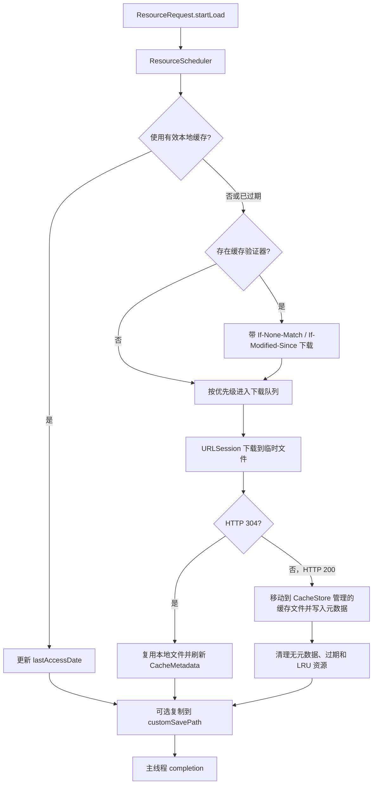

# ResourceTransferKit

`ResourceTransferKit` 是一个面向 iOS 15.6+ 的资源下载与磁盘缓存模块，用于图片、音频、视频、PDF、ZIP 和其他文件的下载。模块负责请求去重、优先级调度、并发限制、进度回调、失败重试、取消以及磁盘缓存管理。

## 集成

当前可通过本地 CocoaPods 路径集成：

```ruby
target 'YourApp' do
  use_frameworks!
  pod 'ResourceTransferKit', :path => '../ResourceTransferKit'
end
```

执行 `pod install` 后，在需要使用的文件中导入模块：

```swift
import ResourceTransferKit
```

## 核心特性

- **请求去重与订阅复用**：以完整 URL 作为资源键；多个调用方同时请求同一资源时，共用一次网络下载，并分别接收进度、成功或失败回调。
- **优先级与受限并发调度**：支持 `.low`、`.normal`、`.high` 三档优先级；在固定并发槽位内优先执行高优先级任务，同优先级按创建顺序处理。
- **可恢复的下载控制**：支持取消、暂停与续传；当大文件下载不再有订阅者时，会尝试保留系统提供的续传数据，后续请求可继续下载。
- **按策略自动重试**：对可恢复的网络错误及部分 HTTP 状态码执行退避重试，并允许每个请求配置自己的最大重试次数。
- **遵循 HTTP 语义的磁盘缓存**：解析 `Cache-Control` 与 `Expires` 判断强缓存有效期；缓存过期后可携带 `ETag` 或 `Last-Modified` 发起条件请求，服务端返回 `304 Not Modified` 时复用本地文件。
- **可控的缓存生命周期**：缓存文件以 URL 的 SHA-256 标识命名，配套持久化元数据；自动清理无索引文件、过期资源，并在超过容量上限后按 LRU 策略回收空间。
- **面向 UI 的安全回调**：进度、成功和失败回调统一在主线程执行，可直接更新 UI；`UIImageView` 提供加载与取消入口，适配列表复用场景。

## 重要组成

- **`ResourceRequest`**：调用方入口，封装资源 URL、优先级、重试上限、缓存读取策略、保存路径及进度/结果回调。
- **`ResourceScheduler`**：模块调度中枢，负责缓存优先判断、相同资源请求合并、优先级排序、并发槽位分配、取消、暂停及重试任务的流转。
- **`DownloadContext`**：单个资源传输的共享上下文，维护订阅者、实时状态、下载进度、HTTP 响应、续传数据及缓存验证信息。
- **`ResourceDownloader` / `DownloadOperation`**：底层下载执行层，基于 `URLSessionDownloadTask` 和 `OperationQueue` 执行受限并发下载，并将进度、完成和失败事件回传给调度器。
- **`CacheStore` / `CacheMetadata`**：磁盘缓存层；前者负责文件存储、索引写入和容量清理，后者保存大小、访问时间和 HTTP 缓存头，用于判断缓存新鲜度与协商缓存。
- **`DownloadResultSubscriber`**：订阅抽象，让同一次资源下载可以服务多个调用方；图片订阅者还可按 `UIImageView` 身份取消旧请求，避免列表复用错图。
- **`UIImageView` 扩展**：提供 `rt_load` 与 `rt_cancel` 两个轻量入口，让图片场景也走统一的调度、缓存和取消逻辑。

## 模块流程



### 磁盘缓存规则

- 缓存根目录为应用沙盒的 `Library/Caches/ResourceTransferKit/Cache`。
- 缓存文件名由资源完整 URL 的 SHA-256 标识生成；元数据统一保存在 `metadata.json`。
- `CacheMetadata` 记录资源键、MIME type、文件大小、最近访问时间、`Cache-Control`、`Expires`、`ETag` 和 `Last-Modified`；只有元数据与对应缓存文件都存在时才视为命中。
- 缓存新鲜度遵循响应的 `Cache-Control` 或 `Expires`。缓存过期后，如存在 `ETag` 或 `Last-Modified`，模块会发送条件请求；服务端返回 `304 Not Modified` 时复用本地文件并刷新元数据，返回新的 `200` 时则覆盖缓存内容。
- 默认最大磁盘占用为 `300 MB`，超过上限后按最近最少使用（LRU）清理到 `80%` 的目标值。
- 缓存文件最多保留 7 天。缓存初始化和每次保存时都会优先删除没有元数据记录的普通文件，随后删除过期资源并执行 LRU 清理。
- 使用 `CacheStore.default.removeAll()` 可清空模块的全部磁盘缓存。

## 多线程下载实现方式

下载由 `ResourceScheduler`、`ResourceDownloader` 和 `DownloadOperation` 协作完成：调度器决定哪些资源可以开始下载，下载器通过 `OperationQueue` 控制同时执行的操作数量，每个操作使用 `URLSessionDownloadTask` 执行网络传输。

### 如何控制下载上限

项目使用 `OperationQueue` 管理下载任务，通过它的 `maxConcurrentOperationCount` 控制同时执行的下载操作数量，也就是最大并发下载数。这个值不代表创建固定数量的线程。

调用方通过以下属性设置最大并发下载数，默认值为 `5`：

```swift
ResourceScheduler.default.maxDownloadCount = 4
```

设置值会传递给 `ResourceDownloader.maxDownloadCount`，被限制在 `3...7` 后，赋给下载队列的 `maxConcurrentOperationCount`。例如设置 `1` 时实际使用 `3`，设置 `10` 时实际使用 `7`。

调度器也使用同一个上限：`startWaitingContextsIfPossible()` 只有在 `downloadingContexts.count < downloader.maxDownloadCount` 时，才从等待队列取出资源、加入下载队列。因此，超过上限的资源会先保留在 `waitingContexts`，等待空位。

### 单个资源如何下载

每个资源的下载由一个继承自 `Operation` 的 `DownloadOperation` 执行，加入 `ResourceDownloader` 的 `OperationQueue` 后，由队列安排启动。

为了让队列跟踪异步下载的生命周期，`DownloadOperation` 重写了以下属性和方法：

| 属性或方法 | 作用 |
| --- | --- |
| `isAsynchronous` | 返回 `true`，声明这是异步操作。 |
| `isExecuting`、`isFinished` | 表示操作是否正在执行、是否已经结束；状态变化时通过 KVO 通知队列，使下载期间持续占用并发名额，结束后释放。 |
| `start()` | 检查取消状态，将操作标记为正在执行，再调用 `main()`。 |
| `main()` | 使用下载器传入的 `URLSession` 创建 `URLSessionDownloadTask`；有断点数据时恢复下载，否则根据请求创建任务。登记 task 与操作的对应关系后，调用 `resume()` 开始下载。 |
| `cancel()` | 取消底层下载任务，并结束操作。 |

`URLSession` 由 `ResourceDownloader` 创建，委托也设置为下载器，因此下载操作通过下载器接收下载结果。

### 等待任务如何调度

`ResourceScheduler` 将待下载资源放入 `waitingContexts`。有空位时，`startWaitingContextsIfPossible()` 按优先级从高到低、同优先级按创建时间从早到晚取出任务，移入 `downloadingContexts` 并提交下载。

任务结束或取消、暂停释放名额后会触发补位；修改并发上限也会重新检查等待队列，降低上限不会取消正在执行的下载。重试任务在等待间隔内不占下载名额，间隔结束后重新入队。

### 如何保证线程安全

调度器和下载器分别用 `NSLock` 保护任务队列、task 与操作的映射；`DownloadOperation` 用 `NSRecursiveLock` 保护操作状态和底层 task，避免下载回调与取消操作并发修改。

进度、成功和失败回调通过 `MainActor` 在主线程执行，调用方可以直接更新 UI。

## 使用方法

### 下载任意资源

```swift
let url = URL(string: "https://example.com/media/video.mp4")!

let request = ResourceRequest(
    url: url,
    priority: .high,
    maxFailRetryCount: 3,
    completion: { result in
        print("缓存文件：\(result.localURL)")
        print("大小：\(result.fileSize ?? 0)")
        print("类型：\(result.expectedType)")
    },
    errorBlock: { error in
        print("下载失败：\(error.localizedDescription)")
    },
    progressBlock: { progress in
        print("进度：\(Int(progress * 100))%")
    }
)

request.startLoad()
```

`ResourceDownloadResult.localURL` 始终指向模块管理的缓存文件，可直接用来读取、播放或复制资源。

### 控制本地缓存读取

`usesCacheIfAvailable` 默认为 `true`。设为 `false` 时，请求会跳过启动时可直接使用的本地缓存，进入下载流程；下载成功后仍会按响应缓存规则更新模块缓存。

```swift
let request = ResourceRequest(
    url: url,
    usesCacheIfAvailable: false
)
```

### 保存一份到业务目录

传入 `customSavePath` 后，模块在下载成功或缓存命中时都会复制一份文件到指定位置；回调中的 `result.localURL` 仍是模块缓存文件地址。

```swift
let cacheURL = URL(string: "https://example.com/files/report.pdf")!
let documentsURL = FileManager.default.urls(
    for: .documentDirectory,
    in: .userDomainMask
)[0]
let destinationURL = documentsURL.appendingPathComponent("report.pdf")

let request = ResourceRequest(
    url: cacheURL,
    customSavePath: destinationURL,
    completion: { result in
        print("缓存：\(result.localURL)")
        print("业务副本：\(destinationURL)")
    }
)
request.startLoad()
```

### 取消请求

保留发起下载的同一个 `ResourceRequest`，再调用 `cancel()`；重新创建一个相同 URL 的请求并不能取消原订阅。

```swift
request.cancel()
```

当同一资源仍有其他订阅者时，取消只移除当前订阅；没有任何订阅者时，底层下载任务会被取消。

### 加载 UIImageView

```swift
imageView.rt_load(
    resourceURL: URL(string: "https://example.com/images/cover.jpg")!,
    completion: { result in
        print("图片文件：\(result.localURL)")
    },
    errorBlock: { error in
        print("图片加载失败：\(error.localizedDescription)")
    }
)

// 视图复用或离开页面时取消。
imageView.rt_cancel()
```

`rt_load` 使用高优先级请求，并通过 `ResourceScheduler` 统一处理缓存命中和旧请求取消，避免旧下载结果覆盖新图片。

### 调整并发量与清空缓存

```swift
ResourceScheduler.default.maxDownloadCount = 4
CacheStore.default.removeAll()
```
